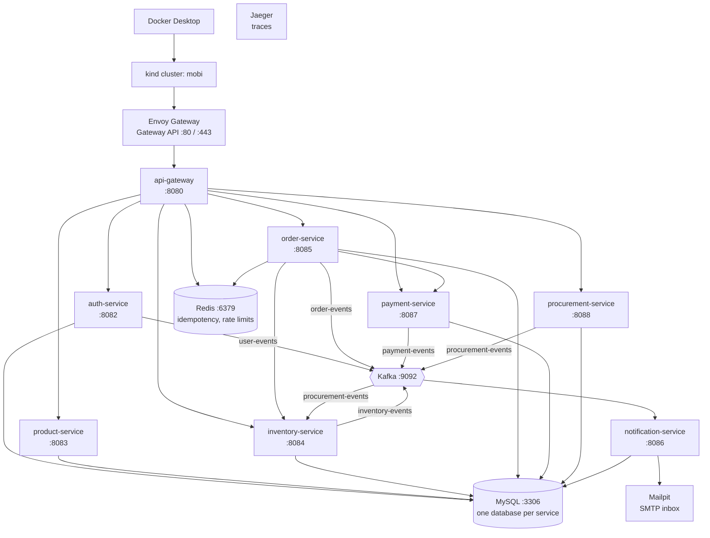

# Backend Reference

Spring Boot microservices powering the Mobi platform.

For AWS infrastructure provisioning see [`infra/terraform/`](infra/terraform/README.md).

## Architecture



Every service also exports spans to Jaeger over OTLP.

## Services

| Service | Port | Description |
| --- | ---: | --- |
| `api-gateway` | `8080` | Gateway entry point for clients |
| `auth-service` | `8082` | Authentication service |
| `product-service` | `8083` | Product API service |
| `inventory-service` | `8084` | Inventory and stock reservation service |
| `order-service` | `8085` | Order creation and checkout saga |
| `payment-service` | `8087` | Idempotent charges and refunds through a pluggable provider |
| `procurement-service` | `8088` | Suppliers, purchase orders, shipment notices and receipts |
| `notification-service` | `8086` | Email and SMS from user, order, and payment events |
| `redis` | `6379` | Order idempotency keys and gateway rate-limit buckets |
| `jaeger` | `4318`, UI `16686` | Trace collector and UI (local only) |
| `mailpit` | `1025`, UI `8025` | SMTP server with a web inbox (local only) |
| `kafka` | `9092` | Kafka broker for asynchronous domain events |
| `mysql` | internal `3306` | MySQL server with separate service-owned databases |

## Requirements

- Docker Desktop
- kind
- kubectl
- Helm

Optional for direct service development:

- Java 21
- Maven wrapper included in each service

## Environment Setup

Copy the example environment file:

```bash
cp .env.example .env.local
```

Edit `.env.local` and set local values:

```bash
MYSQL_ROOT_PASSWORD=localdevpassword

AUTH_DB_PASSWORD=replace-with-local-auth-db-password
PRODUCT_DB_PASSWORD=replace-with-local-product-db-password
INVENTORY_DB_PASSWORD=replace-with-local-inventory-db-password
ORDER_DB_PASSWORD=replace-with-local-order-db-password
PAYMENT_DB_PASSWORD=replace-with-local-payment-db-password
PROCUREMENT_DB_PASSWORD=replace-with-local-procurement-db-password   # generated if empty
NOTIFICATION_DB_PASSWORD=replace-with-local-notification-db-password

# Generated into .env.local by scripts/deploy.sh local when empty.
JWT_PRIVATE_KEY=
ORDER_SERVICE_CLIENT_SECRET=replace-with-local-order-service-client-secret

ADMIN_BOOTSTRAP_ENABLED=true
ADMIN_BOOTSTRAP_USERNAME=admin
ADMIN_BOOTSTRAP_PASSWORD=replace-with-local-admin-password
```

`.env.local` is ignored by git and should never be committed.

## Running Locally With Kubernetes

Start the kind cluster and install Envoy Gateway (also removes a leftover ingress-nginx):

```bash
./scripts/kind-up.sh
```

Build service images and load them into kind:

```bash
./scripts/kind-load-images.sh
```

Deploy MySQL, Redis, Kafka, Jaeger, Mailpit, and the app chart:

```bash
./scripts/deploy.sh local
```

Run the end-to-end smoke test through the edge gateway:

```bash
./scripts/k8s-smoke.sh
```

The app is exposed locally at:

```text
http://localhost
```

## Local Kubernetes Shape

```text
Docker Desktop
  -> kind cluster
    -> Envoy Gateway (Gateway, HTTPRoute, BackendTrafficPolicy)
      -> api-gateway
        -> auth-service
        -> product-service
        -> inventory-service
        -> order-service -> payment-service
        -> payment-service

    -> notification-service
    -> MySQL
    -> Redis
    -> Kafka
    -> Jaeger
    -> Mailpit
```

The app services are deployed through:

```text
helm/mobi
```

Values are layered by `scripts/deploy.sh`, lowest precedence first:

```text
helm/mobi/values.yaml                     neutral base, local defaults
helm/mobi/values-local.yaml               kind only
helm/mobi/values-cloud.yaml               any managed cloud
helm/mobi/values-{aws,gcp,azure}.yaml     load balancer flavour for the edge
helm/mobi/values-<env>.generated.yaml     endpoints from Terraform, gitignored
```

Local deploys use the first two. Cloud deploys use the base plus the last three.
The generated layer is produced by `scripts/render-values.sh <env>` and is never
hand-edited — see [docs/PORTABILITY.md](docs/PORTABILITY.md).

## Database migrations

Flyway owns the schema for the seven services that have one: auth, product,
inventory, order, payment, procurement, and notification. Migrations live in each service's
`src/main/resources/db/migration` and run automatically at startup.

Hibernate is set to `ddl-auto=validate` everywhere, local included. It no longer
creates or alters anything; it only asserts that the entities match the schema
Flyway produced, so drift fails fast at boot instead of being silently patched.

```
V1__baseline.sql   the schema as ddl-auto previously produced it
V2__*.sql          changes since
```

`V1` was generated from the entity mappings by Hibernate's own schema exporter
rather than written by hand, which is why `validate` accepts it. Databases created
before Flyway are stamped at V1 and skip it (`spring.flyway.baseline-on-migrate`),
so existing and fresh databases converge from V2 onward.

To add a change: write `V3__what_it_does.sql`, update the entity to match, and
restart. Never edit an applied migration — Flyway checksums them and will refuse to
start.

Every environment runs **MySQL 8.4 LTS**: RDS (`engine_version = "8.4"`), the local
cluster (`mysql:8.4.13`, `k8s/infra/mysql/mysql.yaml`) and the db-bootstrap client. Keep
them on one major version when changing it.

Flyway migrates *within* a database and does not create one. The databases and
their users come from `k8s/infra/mysql/initdb-configmap.yaml` locally, and from the
`db-bootstrap` pre-install Helm hook on any managed instance — see
[docs/PORTABILITY.md](docs/PORTABILITY.md).

The MySQL image runs that script only on first start, so `./scripts/deploy.sh local`
re-runs it (it is idempotent) on every deploy: a database added later, such as
`procurementdb`, appears on an existing cluster with the next deploy.

## Metrics

Every service exposes Prometheus metrics at `/actuator/prometheus`, tagged with
`application=<service name>`, including HTTP latency histograms with p95/p99.
Pods carry `prometheus.io/scrape` annotations, so a stock Prometheus scrape config
discovers them with no CRDs and no per-cloud setup.

These endpoints are deliberately **not** routable from outside the cluster: the
HTTPRoute exposes only `/actuator/health`. Metrics reveal request patterns, JVM
internals, and the full endpoint inventory.

To read them locally:

```bash
kubectl port-forward -n mobi deployment/order-service 8085:8085
curl http://localhost:8085/actuator/prometheus
```

Also worth graphing: `resilience4j_circuitbreaker_state` (breakers per
dependency), `payments_charges_total` by outcome, and
`notifications_dispatched_total` by channel and outcome.

## Distributed tracing

Every service runs Micrometer Tracing over OpenTelemetry and exports spans over
OTLP to Jaeger. Inbound HTTP requests, Feign calls, Kafka sends and Kafka receives
all become spans, and the W3C `traceparent` header carries the trace between them.

The outbox would normally break the chain, because events are published later by a
scheduler. Each outbox row therefore stores the `traceparent` of the request that
wrote it, and the publisher re-enters that trace before sending (`OutboxTracing`).
A single checkout shows up as one trace: gateway, order-service, product,
inventory, payment, the Kafka publish, and the notification consumer that sends
the receipt.

```bash
kubectl -n mobi port-forward svc/jaeger 16686:16686   # http://localhost:16686
```

Sampling is 100% locally and 10% on a cloud (`TRACING_SAMPLING_PROBABILITY`). On a
cloud, point `OTEL_EXPORTER_OTLP_TRACES_ENDPOINT` at the managed backend (AWS X-Ray
through ADOT, Google Cloud Trace, Azure Monitor, Grafana Tempo).

Log lines carry `[traceId-spanId]`, and the gateway's `X-Correlation-ID` is still
assigned, forwarded, and printed, so logs can be grepped either way:

```bash
kubectl logs -n mobi deployment/order-service | grep "$TRACE_ID"
```

## Edge routing: Gateway API with Envoy Gateway

The community ingress-nginx controller was retired in March 2026. Edge routing now
uses the Kubernetes Gateway API, served by
[Envoy Gateway](https://gateway.envoyproxy.io) (`scripts/install-envoy-gateway.sh`,
pinned to v1.9.3). The chart renders four resources (`helm/mobi/templates/gateway.yaml`):

| Resource | Job |
| --- | --- |
| `EnvoyProxy mobi-edge` | How the Envoy pods and Service run. NodePort 30080 on kind, a cloud load balancer elsewhere. |
| `Gateway mobi` | Listeners: HTTP on 80, and HTTPS on 443 when `gateway.tls.enabled`. |
| `HTTPRoute api-gateway` | The public path prefixes, all to api-gateway, with a 30s request timeout. |
| `BackendTrafficPolicy api-gateway-edge` | Per-IP flood limit (600/min) and retries limited to requests that never reached a pod. |

The same Envoy Gateway runs on kind, EKS, GKE, and AKS. Only the Envoy Service's
load balancer annotations differ per cloud.

## Resilience

order-service wraps every call to product, inventory, and payment in a Resilience4j
circuit breaker (`ResilienceConfig`, `DownstreamCalls`). Only infrastructure
failures count against a breaker (connection errors, timeouts, 5xx). A 404 or 409 is
the downstream service answering correctly and never trips it. When a breaker is
open, calls fail in milliseconds with 503 instead of holding a thread for the full
timeout. Feign keeps its connect/read timeouts and bounded retries inside the breaker.

payment-service has its own breaker around the card provider.

## Kafka error handling

Every consumer (notification-service for all three topics, and order-service's user
projection) uses the same setup:

1. `ErrorHandlingDeserializer` turns a malformed message into a handled error instead
   of a poll loop that never gets past it.
2. `DefaultErrorHandler` retries in place with exponential backoff (1s, 2s, 4s... up to
   30s for order-service, 2 minutes for notification-service, which mostly waits out
   mail server blips).
3. `DeadLetterPublishingRecoverer` then publishes the record to `<topic>.DLT` with the
   exception in its headers, and the partition moves on. Failed-deserialization records
   are written back byte for byte, ready to replay after a fix.

The DLT topics are provisioned with the others in `k8s/infra/kafka/values.yaml`.

## Verification

Gateway health:

```bash
curl http://localhost/actuator/health
curl http://localhost/actuator/health/readiness
curl http://localhost/actuator/health/liveness
```

Cluster status:

```bash
kubectl get pods -n mobi
helm list -n mobi
```

Expected behavior:

- All app and dependency pods are `Running`.
- The `mobi` Helm release is `deployed`.
- The smoke script registers a user, checks refresh-token rotation and reuse detection, seeds product/inventory as the local admin, places an order, pays for it, checks a declined card and a retry, cancels an order, confirms the internal payment endpoint is hidden at the edge, refunds an order as admin, locks an account with 5 wrong passwords and unlocks it, and signs out everywhere. It then runs the procurement flow (catalogue, PO sent, supplier accepts and ships, a second supplier gets 404, warehouse receives 40 + 2 damaged, stock +40 within 10 s, receipt replay adds nothing, close short, supplier 403 on inventory, customer 403 on procurement, the stock sells); skip that with `SMOKE_SKIP_PROCUREMENT=1`. It makes about 22 login/register/refresh calls; kind allows 60 a minute (`values-local.yaml`), clouds 10, so against a cloud run it with `SMOKE_SKIP_LOCKOUT=1` and not twice within a minute.

## Service Routing

Routes are defined in `api-gateway/.../RoutesConfig.java`, with the target URLs
from environment variables that Kubernetes sets to internal Service DNS names:

```text
AUTH_SERVICE_URL=http://auth-service:8082
PRODUCT_SERVICE_URL=http://product-service:8083
INVENTORY_SERVICE_URL=http://inventory-service:8084
ORDER_SERVICE_URL=http://order-service:8085
PAYMENT_SERVICE_URL=http://payment-service:8087
PROCUREMENT_SERVICE_URL=http://procurement-service:8088
```

Any path containing an `/internal/` segment is refused with 404 at the gateway
(`InternalPathBlockingFilter`). Those endpoints are for service-to-service calls only.

### Rate limiting

Two layers:

| Layer | Key | Limit | Where |
| --- | --- | --- | --- |
| Envoy (edge) | client IP | 600/min | `BackendTrafficPolicy`, in-memory per Envoy replica |
| api-gateway | user id if signed in, else client IP | 20/s, bursts of 40 | Redis token bucket, shared by all replicas |
| api-gateway, `/auth/login`, `/register`, `/refresh` | client IP | 10/min (60 on kind) | Redis token bucket |

Over the limit the response is 429 with `X-RateLimit-*` headers. The user id comes
from a verified JWT, so a forged token cannot claim a fresh bucket. The client IP is
the right-most `X-Forwarded-For` hop, the one Envoy appended. If Redis is down the
limiter fails open: requests still pass.

## Configuration

Service configuration lives in each service's `src/main/resources/application.properties` and is overridden by environment variables.

Non-sensitive Kubernetes config is rendered by the app Helm chart into a ConfigMap:

```text
AUTH_DB_URL
PRODUCT_DB_URL
INVENTORY_DB_URL
ORDER_DB_URL
PAYMENT_DB_URL
NOTIFICATION_DB_URL
REDIS_HOST
KAFKA_BOOTSTRAP_SERVERS
```

Sensitive values are created from `.env.local` as the `mobi-secrets` Kubernetes Secret:

```text
AUTH_DB_PASSWORD
PRODUCT_DB_PASSWORD
INVENTORY_DB_PASSWORD
ORDER_DB_PASSWORD
PAYMENT_DB_PASSWORD
NOTIFICATION_DB_PASSWORD
ADMIN_BOOTSTRAP_USERNAME
ADMIN_BOOTSTRAP_PASSWORD
```

The token-signing key and service-client secret go in a second Secret,
`mobi-auth-secrets`, mounted key by key rather than wholesale, so only the services
that need them can read them:

```text
JWT_PRIVATE_KEY               auth-service only
ORDER_SERVICE_CLIENT_SECRET   auth-service and order-service
JWT_PREVIOUS_PUBLIC_KEY       auth-service, optional, during a key rotation
```

Optional provider credentials, when switched on: `STRIPE_SECRET_KEY`,
`MAIL_USERNAME` / `MAIL_PASSWORD`, `TWILIO_ACCOUNT_SID` / `TWILIO_AUTH_TOKEN` /
`TWILIO_FROM_NUMBER`.

For local smoke runs, `auth-service` can bootstrap one admin user from `ADMIN_BOOTSTRAP_*` variables.

## Authentication

```text
POST /auth/register      username, password (8+ chars), optional email and phone (E.164)
POST /auth/login         returns an access token; sets the refresh cookie
POST /auth/refresh       swaps the refresh cookie for a new access token and a new cookie
POST /auth/logout        revokes this session and clears the cookie
POST /auth/logout-all    revokes every session of the signed-in user ("Sign out everywhere")
POST /auth/admin/users/{id}/unlock   admin: lifts a password lockout early
GET  /auth/admin/users/by-ids?ids=1,2 admin: up to 100 users in one call (names for other services' records)
```

- **Access tokens** are JWTs valid for 15 minutes, held in browser memory only and
  never in localStorage.
- **Refresh tokens** are random, valid 14 days, and sent as an `HttpOnly`,
  `SameSite=Strict`, `Path=/auth` cookie (`mobi_refresh`). Only their SHA-256 is
  stored. Every refresh rotates the token. Presenting an already-rotated token is
  treated as theft: the whole session family is revoked.
- **Lockout:** 5 wrong passwords in a row lock the account for 15 minutes (423).
  Unknown usernames cost the same bcrypt work as a wrong password, so timing does
  not reveal which usernames exist.
- **Suspension** by an admin revokes every refresh token immediately. The current
  access token lapses within its 15 minutes, and every refresh re-reads the user,
  so role changes apply at the next refresh.

The frontend refreshes on page load and retries once on any 401, with a single
shared refresh in flight so parallel requests do not trip reuse detection.

### How services verify tokens

Standard OAuth 2.0 / JWT practice, built from Spring Security's stock pieces rather
than hand-written filters:

- **auth-service signs** access tokens with an RSA private key (RS256). It is the
  only service that holds the key, so no other service can mint a token, even if
  its configuration leaks.
- **auth-service publishes** the public keys at `/.well-known/jwks.json` (plus
  RFC 8414 metadata at `/.well-known/oauth-authorization-server`). Neither is
  routed through the edge; only pods inside the cluster use them.
- **Every other service** is a Spring Security *resource server* configured with
  properties alone:

  ```properties
  spring.security.oauth2.resourceserver.jwt.issuer-uri=${JWT_ISSUER}
  spring.security.oauth2.resourceserver.jwt.jwk-set-uri=${JWT_JWK_SET_URI}
  spring.security.oauth2.resourceserver.jwt.audiences=mobi-api
  spring.security.oauth2.resourceserver.jwt.authorities-claim-name=role
  spring.security.oauth2.resourceserver.jwt.authority-prefix=
  ```

  Spring checks signature, expiry, issuer (`iss`) and audience (`aud`), and maps
  the `role` claim to the `ADMIN` / `USER` / `SERVICE` authority. Keys are fetched
  once, cached, and refetched when a token carries an unknown `kid`.
- **The api-gateway** verifies the same way, only to choose a per-user rate-limit
  bucket. Authorization stays with each service.
- **Swapping in Keycloak, Okta or Cognito** means pointing `JWT_ISSUER` and
  `JWT_JWK_SET_URI` at the provider. No service code changes.

Invalid or expired tokens are rejected with `401` and a standard
`WWW-Authenticate: Bearer error="invalid_token"` header, on every endpoint that
receives one. Public endpoints still work without a token; the frontend drops a
dead token and retries once.

### Service-to-service calls

order-service calls inventory-service and payment-service **as itself**, with the
OAuth 2.0 client-credentials grant:

1. order-service posts its client id and secret to auth-service's
   `/oauth2/token` (internal only, not routed by the gateway).
2. It gets a 5-minute token with `sub=order-service` and `role=SERVICE`, and
   Spring Security's OAuth2 client caches it until shortly before expiry.
3. Feign sends it as `Authorization: Bearer ...`. The internal payment endpoints
   and the inventory reservation endpoints require the `SERVICE` authority.

The end user's token is not forwarded: the customer's identity travels in the
request body after order-service has authorised them, and scheduled jobs with no
user, such as releasing expired reservations, work the same way. If auth-service
cannot issue a token, checkout returns `503`.

### Rotating the signing key

1. Generate a new key and set it as `JWT_PRIVATE_KEY`.
2. Put the old key's public half in `JWT_PREVIOUS_PUBLIC_KEY`
   (`openssl pkey -in old.pem -pubout`) and deploy. Both keys are published.
3. After 15 minutes every old token has expired; remove `JWT_PREVIOUS_PUBLIC_KEY`.

## Product API

`product-service` uses REST-style product routes:

```text
GET    /productapi/products
GET    /productapi/products/{id}
POST   /productapi/products
PUT    /productapi/products/{id}
DELETE /productapi/products/{id}
```

Product stock is intentionally not stored on the product record. Stock belongs to `inventory-service`.
Product mutations require an `ADMIN` token; product reads remain public.

## Inventory API

```text
GET   /inventoryapi/products                          public: stock levels
GET   /inventoryapi/products/{productId}              public
POST  /inventoryapi/products/{productId}/adjustments  WAREHOUSE, ADMIN
GET   /inventoryapi/products/{productId}/adjustments  WAREHOUSE, ADMIN: the ledger, newest first
PATCH /inventoryapi/products/{productId}              WAREHOUSE, ADMIN: location, reorder level
POST  /inventoryapi/reservations[/{key}/release|confirm|return]   SERVICE, ADMIN: checkout only
```

**Stock ledger.** Outside checkout, stock changes only through an adjustment, which updates
the stock record and appends a `stock_adjustments` row (delta, reason, note, who, resulting
level) in one transaction under a row lock.

- Reasons and the direction each one allows: `INITIAL` (+), `RECEIVED` (+),
  `DAMAGED` (−), `LOST` (−), `COUNT_CORRECTION` (±).
- A note is required for everything except `INITIAL`.
- `RECEIVED` can't be entered by hand: it comes only from receiving a purchase order
  (see `docs/specs/procurement.md`). Adjustments carrying a reference are applied at most
  once per product.
- Stock never goes below 0.
- A product's first positive adjustment creates its stock record, so there is no separate
  setup step.
- `reorderLevel` > 0 makes `lowStock` true at or below it.

## Procurement API

procurement-service (`:8088`, database `procurementdb`) holds suppliers, their catalogues
and purchase orders. Design and phases: [docs/specs/procurement.md](docs/specs/procurement.md).

```text
GET   /procurementapi/suppliers                          ADMIN, WAREHOUSE
POST  /procurementapi/suppliers                          ADMIN
PUT   /procurementapi/suppliers/{id}                     ADMIN
GET   /procurementapi/suppliers/{id}/products            ADMIN, WAREHOUSE (costs: admin only)
PUT   /procurementapi/suppliers/{id}/products            ADMIN: replaces the catalogue
GET   /procurementapi/purchase-orders?status=&supplierId=&page=&size=
                                                         ADMIN, WAREHOUSE; SUPPLIER: own, no drafts
GET   /procurementapi/purchase-orders/{id}               ADMIN, WAREHOUSE, own SUPPLIER
POST  /procurementapi/purchase-orders                    ADMIN: creates a DRAFT
PUT   /procurementapi/purchase-orders/{id}               ADMIN: DRAFT only
POST  /procurementapi/purchase-orders/{id}/send          ADMIN
POST  /procurementapi/purchase-orders/{id}/cancel        ADMIN  { "note": "optional" }
POST  /procurementapi/purchase-orders/{id}/close         ADMIN  { "note": "required" }: close short
POST  /procurementapi/purchase-orders/{id}/accept        own SUPPLIER  { "expectedDate": "2026-12-01" }
POST  /procurementapi/purchase-orders/{id}/reject        own SUPPLIER  { "note": "required" }
POST  /procurementapi/purchase-orders/{id}/shipments     own SUPPLIER  carrier, tracking, lines
```

```text
DRAFT ─send─► SENT ─accept─► ACCEPTED ─shipment─► SHIPPED ─receipt─► PARTIALLY_RECEIVED ─► RECEIVED
                └─reject─► REJECTED                       close short (admin) ──────────────►┘
cancel (admin): from DRAFT, SENT, ACCEPTED or SHIPPED; never once goods are counted in
```

- Every transition is checked in `PurchaseOrderStateMachine`; a refused one is `409`.
  `@Version` on the PO turns two people acting at once into a `409` too.
- A PO line must be a product in the supplier's catalogue. Its unit cost defaults to the
  catalogue price, and the PO keeps that cost if the catalogue changes later.
- "Own SUPPLIER" means the token's `supplier_id` claim matches the PO. Anything else is
  `404`, not `403`, so suppliers can't probe for other suppliers' POs.
- Who sees what: warehouse responses leave out costs and totals; supplier responses leave
  out internal fields such as `createdBy`. Every PO response lists the `actions` the caller
  can take next, which the UI turns into buttons.
- A shipment notice is the supplier's word only: each line may announce at most what is
  still outstanding (not yet counted in), so replacements after a short receipt are
  possible; it moves an accepted PO to `SHIPPED`.
- Suppliers see only POs that were actually sent: drafts, and drafts cancelled before
  sending, are `404` to them. **Stock goes up only when the
  warehouse counts goods in.**
- Status changes are published to `procurement-events` through the outbox: `PO_SENT`,
  `PO_ACCEPTED`, `PO_REJECTED`, `SHIPMENT_NOTICE_CREATED`, `GOODS_RECEIVED`. Keyed by PO id;
  each carries the supplier's name and contact email.

**Receiving.**

```text
POST /procurementapi/purchase-orders/{id}/receipts     WAREHOUSE, ADMIN
Idempotency-Key: <one per submit, reused on retry>
{ "note": "2 crushed", "lines": [ { "poLineId": 11, "quantityGood": 40, "quantityDamaged": 2 } ] }
```

1. One transaction in procurement: the receipt and its lines, the PO's running totals and
   status (`PARTIALLY_RECEIVED`, or `RECEIVED` once every line's good + damaged reaches what
   was ordered), and a `GOODS_RECEIVED` outbox row.
2. inventory-service consumes it and, per line with good units, adds a `RECEIVED` ledger
   entry referenced `PO_RECEIPT:<receiptId>`. Damaged units never enter stock.
3. Exactly-once effect: the outbox publishes at least once, and the ledger applies a
   reference at most once per product. inventory applies a whole receipt in one
   transaction and retries database errors for up to 15 minutes before dead-lettering.
   A replayed Idempotency-Key with the same counts returns the PO without counting again;
   with different counts, or on another PO, it is `409`.
4. Two simultaneous submits with one key: the loser's insert hits the unique key and is
   retried once, which finds the winner's receipt and returns the same result.
5. Counting more than a line's outstanding units is `409`. Stock appears within seconds;
   unreadable records go to `procurement-events.DLT` after the usual retries.

**Low stock.** inventory-service publishes `LOW_STOCK` on `inventory-events` (through its own
outbox) when a ledger adjustment or a **confirmed** sale takes a product's unsold stock
(available + reserved) from above its reorder level to at or below it. Reserving or
releasing a cart doesn't move unsold stock, so abandoned carts raise nothing and
overlapping reservations can't double-count; a product that stays low doesn't alert again
until it recovers.

Suppliers get `403` on every `/inventoryapi/**` endpoint, including the stock levels that
are public to everyone else.
- Supplier `1`, "Mobi Distribution", is created by a migration and linked to the seeded
  `supplier` login. `scripts/seed-phones.sh` gives it every product at 60 % of retail and
  sends it one purchase order.

## Order API

`order-service` owns order state and uses synchronous HTTP clients to validate products and reserve inventory:

```text
POST   /orderapi/orders
GET    /orderapi/orders
GET    /orderapi/orders/{id}
GET    /orderapi/users/{userId}/orders
POST   /orderapi/orders/{id}/pay        { "paymentMethodToken": "tok_visa" }
POST   /orderapi/orders/{id}/cancel
POST   /orderapi/orders/{id}/confirm    admin only: confirm without payment
POST   /orderapi/orders/{id}/refund     admin only: { "reason": "...", "restock": true } refunds, order -> REFUNDED
```

Checkout is a saga orchestrated by order-service:

```text
POST /orders
  -> product-service: fetch active product and price snapshot
  -> inventory-service: reserve stock
  -> orderdb: INVENTORY_RESERVED (or CANCELLED)

POST /orders/{id}/pay
  -> payment-service: charge, idempotency key order-<id>-attempt-<n>
       declined     -> 402, order stays INVENTORY_RESERVED, attempt n+1 gets a new key
       no answer    -> 503, a retry reuses the key and gets the original result
  -> inventory-service: confirm the reservation
       confirmed    -> order CONFIRMED
       4xx (expired)-> refund the charge, order CANCELLED   (compensation)
       unreachable  -> payment recorded on the order, 503, retry completes it
```

The amount always comes from the order, never the client. Orders carry an
optimistic lock, so two simultaneous pay clicks cannot both move one forward.

Order creation supports an optional `Idempotency-Key` request header. Reusing the same key for a previously completed order returns the original order response instead of creating a duplicate order.
Order reads and commands are restricted to the order owner or an `ADMIN`; listing all orders is admin-only.
Order confirmation is idempotent after an order reaches `CONFIRMED`.

After order state changes, `order-service` writes asynchronous domain events to an outbox table and a scheduled publisher forwards them to Kafka topic `order-events`. Every service's publisher takes its batch with `SELECT ... FOR UPDATE SKIP LOCKED`, so several replicas never send the same rows. A row that fails is retried on later runs without holding up the rows behind it, so consumers must tolerate redelivery and reordering.

## Payment API

```text
GET  /paymentapi/payments/{paymentId}                 owner or admin
GET  /paymentapi/orders/{orderId}/payments            owner or admin
GET  /paymentapi/admin/payments?page=&size=           admin
POST /paymentapi/internal/payments                    order-service only
POST /paymentapi/internal/payments/{id}/refund        order-service only
```

- **Refunds go through the order.** An admin refunds with
  `POST /orderapi/orders/{id}/refund`; order-service calls the internal refund and
  marks the order `REFUNDED`, so the order and its payment cannot disagree. There is
  deliberately no refund endpoint an admin can call on payment-service directly.
  With `"restock": true` the sold quantities also go back into available stock
  (inventory-service `POST /inventoryapi/reservations/{key}/return`, idempotent); the
  default is not to, since damaged or unreturned goods should not be resold. The
  order is marked `REFUNDED` only after every step succeeds, so a failed refund can
  be retried as a whole.

- **Idempotent on the caller's key.** The unique index on `idempotency_key` is the
  lock: a concurrent duplicate fails its insert instead of reaching the provider. A
  retry returns the stored result. Separately, at most one payment per order can
  succeed, whatever key it arrives with.
- **No card data.** Clients send a provider token; only brand and last four digits
  are stored.
- **Providers** (`PAYMENT_PROVIDER`): `simulated` (default, Stripe-style test tokens:
  `tok_visa` and `tok_mastercard` succeed, `tok_chargeDeclined`,
  `tok_chargeDeclinedInsufficientFunds` and `tok_chargeDeclinedExpiredCard` decline,
  `tok_providerError` simulates an outage, `tok_slow` a timeout) or `stripe` (real
  PaymentIntents with `STRIPE_SECRET_KEY`; untested against a live account).
- Events `PAYMENT_SUCCEEDED`, `PAYMENT_DECLINED` and `PAYMENT_REFUNDED` go to
  `payment-events` through the outbox.

## Notifications

notification-service consumes `user-events`, `order-events`, `payment-events`,
`procurement-events` and `inventory-events`, and sends:

| Event | Email | SMS |
| --- | --- | --- |
| USER_REGISTERED | Welcome | |
| ORDER_INVENTORY_RESERVED | Items reserved, please pay | |
| ORDER_CONFIRMED | Order confirmed, with line items | Yes |
| ORDER_CANCELLED | Order cancelled | |
| PAYMENT_SUCCEEDED | Receipt | |
| PAYMENT_DECLINED | Payment declined | Yes |
| PAYMENT_REFUNDED | Refund issued | |
| PO_SENT | The PO, to the supplier's contact email | |
| PO_ACCEPTED / PO_REJECTED | Supplier's answer (and reason), to every admin | |
| SHIPMENT_NOTICE_CREATED | Inbound shipment, to every warehouse user | |
| LOW_STOCK | Low stock, to every admin | |

- **Staff email** goes to every enabled account with the role, from the `role` on
  `user-events` (projected into `user_contacts.role`). Each recipient is deduplicated on
  its own (`eventId:userId`); one failing recipient doesn't stop the others. While the user
  projection is still empty (first start) the event is retried; once users are known, a
  role with nobody in it is recorded as skipped rather than retried.
- auth-service republishes every staff account (admin, warehouse, supplier) as a snapshot
  on every start, so the projection always knows the staff. Locally the bootstrap accounts
  get emails from `*_BOOTSTRAP_EMAIL` (defaults `admin@mobi.local`, `warehouse@mobi.local`).
- An address the mail server permanently rejects (SMTP 5.1.x, the mailbox itself) is
  recorded as skipped instead of retried forever; 5.7.x (relay or auth refused, i.e. our
  own mail setup) stays retryable so it gets noticed. Old staff events skipped by the age limit are recorded too.
- Product names come from product-service's public API (`PRODUCT_SERVICE_URL`), cached;
  if it can't be reached the email still goes out naming the product by id, and it isn't
  asked again for a minute.
- Purchase-order and low-stock emails for events older than 24 h
  (`NOTIFICATION_STAFF_MAX_EVENT_AGE`) are skipped, so a consumer reading its topics from
  the beginning on first start doesn't re-send old ones.

- **Email** is HTML from Thymeleaf templates (`templates/email/`) over SMTP:
  Mailpit locally (`kubectl -n mobi port-forward svc/mailpit 8025:8025`), any relay
  such as Amazon SES in the cloud via `MAIL_*` settings.
- **SMS** is logged by default (`SMS_PROVIDER=log`); `twilio` sends through Twilio.
  It only goes to users who gave a phone number at signup.
- Contact details come from its own projection of `user-events`
  (`user_contacts`), so an auth-service outage does not stop email.
- `notifications` records every send with a unique `(event_id, channel)`, so a
  redelivered event never sends twice. A send that fails is not recorded and is
  retried, then dead-lettered.

## Development

To test an individual service directly, use Java 21:

```bash
cd auth-service
./mvnw test
```

Each runnable service has its own Maven wrapper and Dockerfile.

## Troubleshooting

### Port already in use

kind maps local ports `80` and `443` to the Envoy edge proxy (NodePorts 30080/30443). Check the process using a port:

```bash
lsof -iTCP:80 -sTCP:LISTEN
```

### View logs

```bash
kubectl logs -n mobi deployment/api-gateway -f
kubectl logs -n mobi deployment/auth-service -f
kubectl logs -n mobi deployment/product-service -f
```

### Rebuild and redeploy

```bash
./scripts/kind-load-images.sh
./scripts/deploy.sh local
```

### Reset the local cluster

```bash
kind delete cluster --name mobi
./scripts/kind-up.sh
./scripts/kind-load-images.sh
./scripts/deploy.sh local
```
