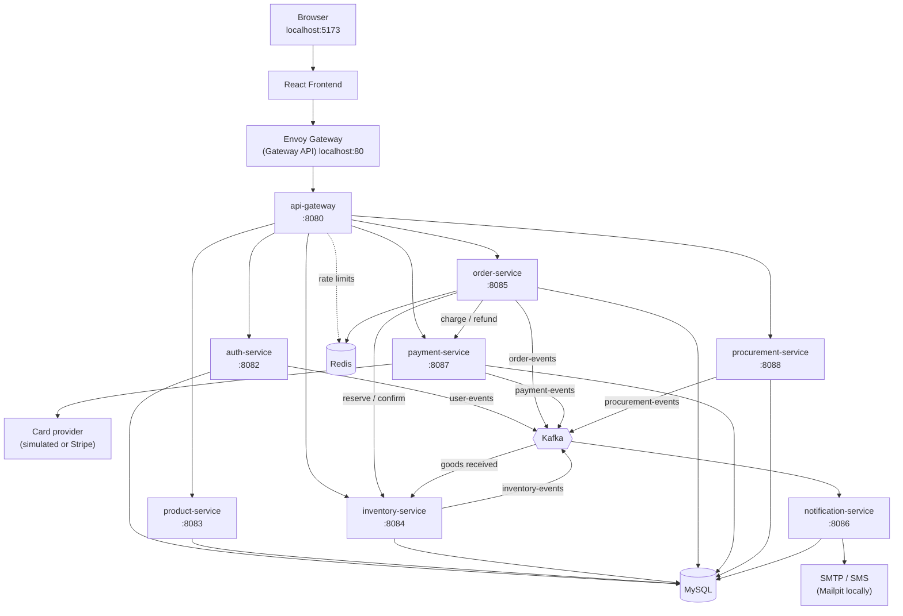

# Mobi

Mobi is a full-stack phone store platform built to demonstrate production-grade microservices architecture. The backend is a set of independently deployable Spring Boot services communicating through a Spring Cloud Gateway, with asynchronous domain events over Kafka and service-owned MySQL databases. The frontend is a React + TypeScript operations console with role-based access for admins and customers.

The project runs entirely on Kubernetes locally using kind, and is designed to deploy to AWS EKS with infrastructure provisioned by Terraform. Swapping in-cluster dependencies (MySQL, Redis, Kafka) for RDS, ElastiCache, and MSK is a config-only change.

**Key design decisions:**
- Each service owns its own database. No shared schema, no cross-service joins.
- Order creation uses an outbox pattern to guarantee Kafka events are published even if the broker is temporarily unavailable.
- Idempotency keys on order creation prevent duplicate orders from retried requests.
- Checkout is an orchestrated saga: reserve stock, charge the card, confirm the sale, and refund automatically if the reservation expired mid-payment. Charges are idempotent, so a retried payment never charges twice.
- Every synchronous call between services runs through a Resilience4j circuit breaker, with timeouts and bounded retries.
- Kafka consumers retry with exponential backoff, then park failing records on a `<topic>.DLT` dead-letter topic instead of blocking the partition.
- Distributed tracing with OpenTelemetry: one trace follows a request across HTTP calls, the outbox, and Kafka, viewable in Jaeger.
- Two layers of rate limiting: per-IP flood protection in Envoy at the edge, and per-user token buckets in Redis at the API gateway, with a stricter limit on login.
- Short-lived (15 minute) access tokens held only in memory, renewed by rotating refresh tokens in an httpOnly cookie, with reuse detection and account lockout after repeated failed logins.
- RS256 JWTs signed only by auth-service; every service verifies them itself with Spring Security's resource server and the published public keys (JWKS). Services call each other with OAuth2 client-credentials tokens.
- Edge routing uses the Kubernetes Gateway API, served by Envoy Gateway (the community ingress-nginx controller was retired in March 2026).
- All sensitive config flows through Kubernetes Secrets. Non-sensitive config is rendered by a Helm-managed ConfigMap.

## Architecture



## Services

| Service | Port | Description |
| --- | ---: | --- |
| `api-gateway` | `8080` | Gateway entry point |
| `auth-service` | `8082` | Registration, login, JWT |
| `product-service` | `8083` | Product catalog |
| `inventory-service` | `8084` | Stock reservation |
| `order-service` | `8085` | Checkout saga and order lifecycle |
| `payment-service` | `8087` | Idempotent charges and refunds behind a provider seam |
| `procurement-service` | `8088` | Suppliers and purchase orders: send, accept, ship, receive |
| `notification-service` | `8086` | Email and SMS from domain events |

## Quick Start

New here? Follow **[docs/LOCAL_SETUP.md](docs/LOCAL_SETUP.md)**, a step-by-step guide covering
prerequisites, Docker memory, the `.env.local` file, demo data, the main flows and
troubleshooting. The short version, once `.env.local` exists:

```bash
# 1. Start the Kubernetes cluster
./scripts/kind-up.sh

# 2. Build and load service images
./scripts/kind-load-images.sh

# 3. Deploy dependencies and app
./scripts/deploy.sh local

# 4. Start the frontend (separate terminal)
cd frontend && npm install && npm run dev
```

Backend available at `http://localhost` · Frontend at `http://localhost:5173`

Pay with the test cards on the order page (`tok_visa` succeeds, `tok_chargeDeclined` is declined). To see what happened behind the scenes:

```bash
kubectl -n mobi port-forward svc/mailpit 8025:8025   # emails sent: http://localhost:8025
kubectl -n mobi port-forward svc/jaeger 16686:16686  # traces:      http://localhost:16686
```

## User Roles

| Role | Access |
| --- | --- |
| User | Browse products, add to cart, place, pay for, and cancel own orders |
| Admin | All of the above + manage products, suppliers and purchase orders, view inventory, view all orders, confirm an order without payment (manual override), refund payments, assign roles |
| Warehouse | Inventory (adjust stock, every change logged), Receiving (count deliveries in against a purchase order), purchase orders read-only without costs |
| Supplier | An outside company's login: its own purchase orders only. Accept or reject, send shipment notices, see what was received. No stock access |

Demo `admin`, `warehouse` and `supplier` accounts are seeded at startup from the `*_BOOTSTRAP_*` environment variables (local only; off in cloud).

## Docs

- [Backend reference](BACKEND.md) — services, APIs, configuration, Kubernetes, troubleshooting
- [Frontend reference](frontend/README.md) — stack, structure, running locally, production build
- [Terraform / AWS infrastructure](infra/terraform/README.md) — modules, staging vs production, deploy sequence
- [AWS deployment notes](k8s/AWS_DEPLOYMENT_NOTES.md) — app-level changes required for production
