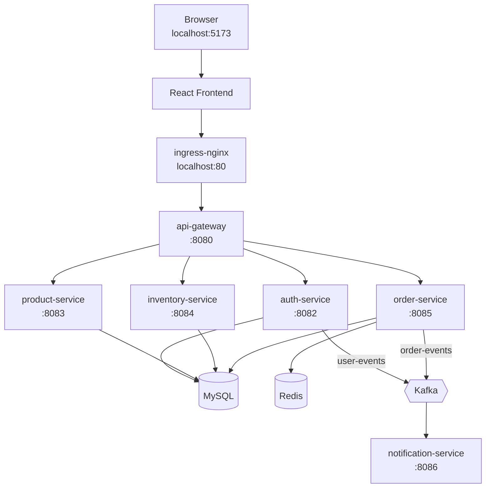

# Mobi

A phone store platform built with Spring Boot microservices and a React operations console.

## Architecture



## Services

| Service | Port | Description |
| --- | ---: | --- |
| `api-gateway` | `8080` | Gateway entry point |
| `auth-service` | `8082` | Registration, login, JWT |
| `product-service` | `8083` | Product catalog |
| `inventory-service` | `8084` | Stock reservation |
| `order-service` | `8085` | Checkout and order lifecycle |
| `notification-service` | `8086` | Kafka consumer for domain events |

## Quick Start

```bash
# 1. Start the Kubernetes cluster
./scripts/kind-up.sh

# 2. Build and load service images
./scripts/kind-load-images.sh

# 3. Deploy dependencies and app
./scripts/k8s-deploy.sh

# 4. Start the frontend (separate terminal)
cd frontend && npm install && npm run dev
```

Backend available at `http://localhost` · Frontend at `http://localhost:5173`

## User Roles

| Role | Access |
| --- | --- |
| User | Browse products, add to cart, place and cancel own orders |
| Admin | All of the above + manage products, view inventory, view and confirm all orders |

The admin account is seeded at startup via `ADMIN_BOOTSTRAP_*` environment variables.

## Docs

- [Backend reference](BACKEND.md) — services, APIs, configuration, Kubernetes, troubleshooting
- [Frontend reference](frontend/README.md) — stack, structure, running locally, production build
