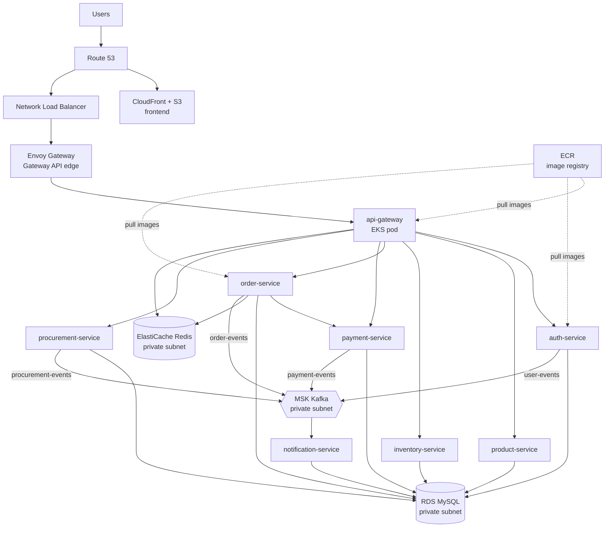

# AWS Deployment Notes

Infrastructure is provisioned with Terraform. See [`infra/terraform/`](../infra/terraform/README.md) for the full module structure and usage.

## Architecture



## AWS target mapping

| Local | AWS |
| --- | --- |
| kind | EKS |
| local Docker images | ECR images |
| Envoy Gateway on NodePort | Envoy Gateway behind an NLB (AWS Load Balancer Controller) |
| in-cluster MySQL | RDS MySQL |
| in-cluster Redis | ElastiCache Redis |
| in-cluster Kafka | MSK |
| Kubernetes Secret from `.env.local` | AWS Secrets Manager + External Secrets Operator |

## Deploy sequence

```bash
# 1. Provision infrastructure
terraform -chdir=../infra/terraform/envs/aws-staging apply -var="db_password=<password>"

# 2. Build and push images, tagged with the commit SHA
#    REGISTRY_PREFIX comes from the registry_prefix Terraform output.
#    ECR repositories are IMMUTABLE, so a moving tag like "latest" is rejected.
aws ecr get-login-password --region <region> \
  | docker login --username AWS --password-stdin "$REGISTRY_PREFIX"
for svc in api-gateway auth-service product-service inventory-service order-service payment-service procurement-service notification-service; do
  docker buildx build --push -t "$REGISTRY_PREFIX/$svc:$(git rev-parse --short HEAD)" "../$svc"
done

# 3. Install Envoy Gateway once per cluster (needs the AWS Load Balancer Controller)
../scripts/install-envoy-gateway.sh

# 4. Render Helm values from Terraform outputs, then deploy
../scripts/render-values.sh aws-staging
../scripts/deploy.sh aws-staging
```

Step 4 replaces what used to be a manual "paste the Terraform outputs into
`values-aws.yaml`" step. Endpoints, registry paths, and image tags are generated;
`helm/mobi/values-aws.yaml` now holds nothing but the NLB annotations for the Envoy edge Service. See
[docs/PORTABILITY.md](../docs/PORTABILITY.md).

## What is already handled

These were previously manual pre-deploy edits. They now apply automatically to
every cloud environment via `helm/mobi/values-cloud.yaml`:

| Setting | Where it lives now |
| --- | --- |
| NLB annotations for the Envoy edge | `values-aws.yaml` |
| Hibernate `ddl-auto: validate` | `values-cloud.yaml` |
| `ADMIN_BOOTSTRAP_ENABLED: "false"` | `values-cloud.yaml` |
| `JAVA_TOOL_OPTIONS` heap pinning | `values-cloud.yaml` |
| CPU/memory requests and limits | `values-cloud.yaml` |
| Horizontal autoscaling and disruption budgets | `values-cloud.yaml` |
| RDS / ElastiCache / MSK endpoints | generated by `scripts/render-values.sh` |
| Skipping in-cluster MySQL, Redis, Kafka | `scripts/deploy.sh`, from the env name |
| Creating the per-service databases and users | `db-bootstrap` pre-install Helm hook |
| Applying the database schema | Flyway, at each service's startup |

In-cluster dependencies are installed by `scripts/deploy.sh` only for the `local`
target. They are separate Helm releases under `k8s/infra/`, not subcharts of
`helm/mobi`, so there is no `mysql.enabled` flag to turn off.

## Still manual

**metrics-server** — the HPAs enabled by `values-cloud.yaml` scale on CPU
utilization, which is served by metrics-server. GKE and AKS ship it; **EKS does
not**. Without it the HorizontalPodAutoscaler reports `<unknown>/70%` and simply
never scales — it does not error, and the deployment otherwise looks healthy, so
this is easy to miss until load arrives:

```bash
kubectl apply -f https://github.com/kubernetes-sigs/metrics-server/releases/latest/download/components.yaml
kubectl get hpa -n mobi   # TARGETS must show a percentage, not <unknown>
```

**TLS**: the Gateway listens on HTTP :80. For HTTPS, set `gateway.hostname`, issue a
certificate into a TLS Secret (cert-manager), and set `gateway.tls.enabled` and
`gateway.tls.secretName`; see the comment in `helm/mobi/values-aws.yaml`.

**Secrets** — `scripts/deploy.sh` requires `mobi-secrets` to already exist in the
namespace for cloud environments, and deliberately will not copy `.env.local` into
a shared cluster. Populate it from Secrets Manager, ideally via External Secrets
Operator. Alongside it, `mobi-auth-secrets` must hold `JWT_PRIVATE_KEY` and
`ORDER_SERVICE_CLIENT_SECRET` (see `k8s/base/secrets.example.yaml`). On top of the
per-service passwords, cloud deploys also
need `MYSQL_ADMIN_USERNAME` and `MYSQL_ADMIN_PASSWORD` — the RDS master credentials
from `var.db_username` / `var.db_password`, used by the `db-bootstrap` hook to create
the per-service databases. `deploy.sh` fails fast if they are absent.

**Frontend** — serve from S3 + CloudFront, not in-cluster. Build `frontend/` and
upload `dist/` to an S3 bucket with CloudFront in front. API calls route to the edge load balancer
domain. Alternatively, since `frontend/` already ships a Dockerfile and nginx
config, adding it as another in-cluster service behind the same Gateway avoids a
per-cloud CDN module entirely.
