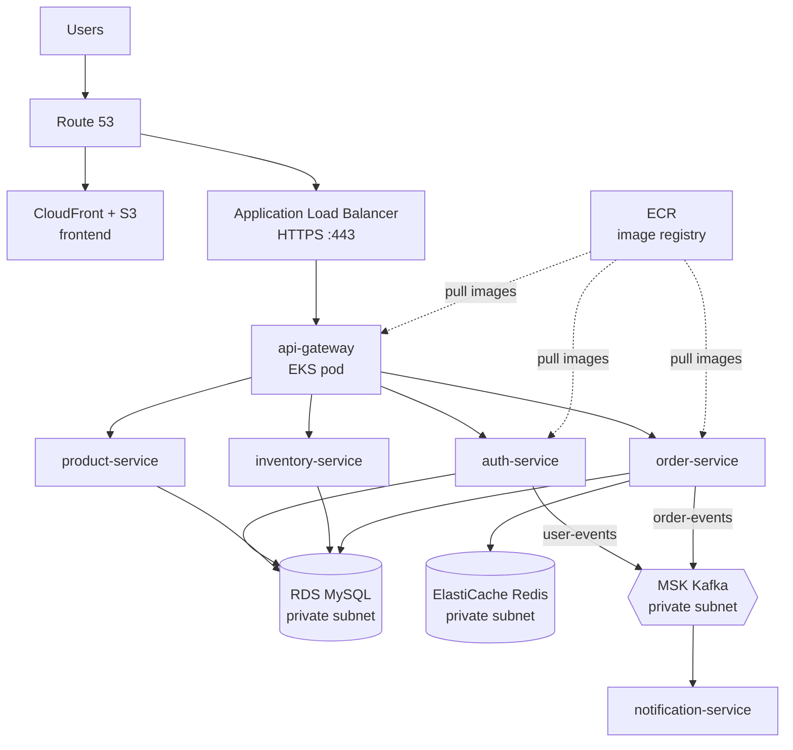

# AWS Deployment Notes

Infrastructure is provisioned with Terraform. See [`infra/terraform/`](../infra/terraform/README.md) for the full module structure and usage.

## Architecture



## AWS target mapping

| Local | AWS |
| --- | --- |
| kind | EKS |
| local Docker images | ECR images |
| ingress-nginx | AWS Load Balancer Controller |
| in-cluster MySQL | RDS MySQL |
| in-cluster Redis | ElastiCache Redis |
| in-cluster Kafka | MSK |
| Kubernetes Secret from `.env.local` | AWS Secrets Manager + External Secrets Operator |

## Deploy sequence

1. **Provision infra** — `terraform apply` in `infra/terraform/envs/staging` or `production`
2. **Push images** — build each service, tag with Git SHA, push to ECR
3. **Deploy app** — fill `helm/mobi/values-aws.yaml` with Terraform outputs, then:

```bash
helm upgrade --install mobi helm/mobi \
  --namespace mobi \
  --values helm/mobi/values-aws.yaml
```

## App-level changes for production

**Ingress** — swap nginx for ALB in `values-aws.yaml`:

```yaml
ingress:
  className: alb
  annotations:
    alb.ingress.kubernetes.io/scheme: internet-facing
    alb.ingress.kubernetes.io/target-type: ip
    alb.ingress.kubernetes.io/certificate-arn: arn:aws:acm:<region>:<account>:certificate/<id>
    alb.ingress.kubernetes.io/listen-ports: '[{"HTTPS":443}]'
```

**Disable in-cluster dependencies** — once Terraform has provisioned RDS, ElastiCache, and MSK:

```yaml
mysql:
  enabled: false
redis:
  enabled: false
kafka:
  enabled: false
```

**JVM heap** — set explicitly to avoid OOMKilled:

```yaml
env:
  JAVA_TOOL_OPTIONS: "-Xms256m -Xmx512m"
```

**Admin bootstrap** — disable after first deploy once the admin account exists:

```yaml
config:
  ADMIN_BOOTSTRAP_ENABLED: "false"
```

**Frontend** — serve from S3 + CloudFront, not in-cluster. Build `frontend/` and upload `dist/` to an S3 bucket with CloudFront in front. API calls route to the ALB domain.
